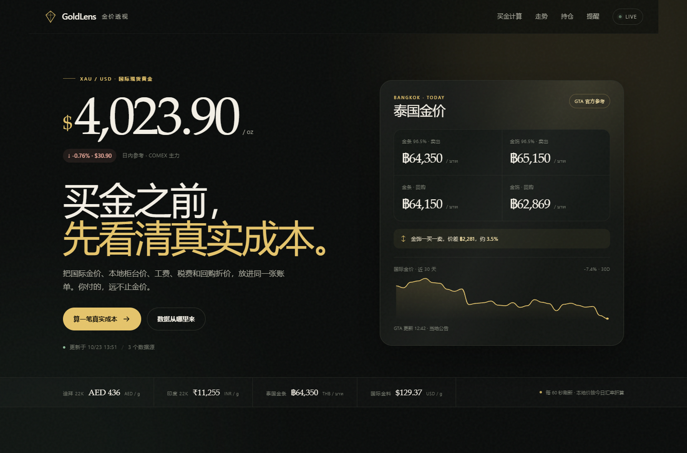

# GoldLens 金价透视

[](https://github.com/death1024/goldlens-mvp/actions/workflows/ci.yml)
[](https://github.com/death1024/goldlens-mvp/actions/workflows/pages.yml)

> 买金之前，先看清真实成本。

**在线 Demo：** https://death1024.github.io/goldlens-mvp/  
**GitHub：** https://github.com/death1024/goldlens-mvp

GoldLens 是一个面向消费者黄金购买决策的 Web MVP：把国际金价、泰国 GTA 本地参考价、工费、税费、回购折价和回本点，放进同一张可交互的账单。

这个仓库同时包含：

- **可运行的 MVP**：实时行情、四市场换算、真实成本计算器、回购/回本点、持仓、价格提醒。
- **完整调研报告**：Google Trends 33 个地区 330 条热搜、10 个应用场景评分、9 款竞品对标、商业模式、90 天路线图。
- **工程化配套**：PWA、离线快照、静态 Demo、Docker、CI、GitHub Pages 工作流。



---

## 快速开始

要求：Node.js 24+，无需安装依赖。

```bash
npm start
# 打开 http://127.0.0.1:5188
```

或：

```bash
cd mvp
node server.mjs
```

健康检查：`GET /health`  
市场数据：`GET /api/market`

### 静态 Demo

如果只部署 `mvp/public`（例如 GitHub Pages），没有 Node 后端也能运行：前端会请求 `./api/market`，失败后自动回退到 `./data/market.json` 快照。页面右上角显示 `DEMO`，所有计算、持仓、提醒仍可使用。

---

## 已实现功能

| 模块 | 内容 |
|---|---|
| 实时行情 | XAU/USD 现货 + COMEX 主力 1 年日线 + 汇率 |
| 泰国本地价 | GTA 96.5% 金条/金饰的卖出与回购价 |
| 四市场 | 泰国 THB/96.5%、阿联酋 AED/22K、印度 INR/22K、美国 USD/24K |
| 四单位 | baht（15.244g）、克、tola（11.6638g）、盎司 |
| 真实成本 | 金料、工费/溢价、税费、到手价、市场溢价 |
| 回购/回本 | 即时回购、一买一卖隐形成本、金价需上涨多少才回本 |
| 价格位置 | 30D/90D/1Y、52 周高/低、当前 vs 均价 |
| 持仓 | 本地保存、按回购价估值、浮动盈亏 |
| 提醒 | 浏览器内保存、页面打开时检查、系统通知 |
| PWA | manifest、Service Worker、安装按钮、离线 shell |
| 数据降级 | 单源失败显示“快照”；无后端显示“DEMO” |

> 说明：账户体系、真实交易、KYC、托管、门店实时报价、后台推送不在 MVP 范围内。

---

## 项目结构

```
goldlens/
├── mvp/
│   ├── server.mjs               # Node HTTP 服务、数据聚合、缓存、fallback
│   ├── public/
│   │   ├── index.html           # 页面结构
│   │   ├── styles.css           # 深色黄金视觉与响应式布局
│   │   ├── app.js               # 计算、图表、持仓、提醒、PWA 注册
│   │   ├── sw.js                # Service Worker
│   │   ├── manifest.webmanifest # PWA manifest
│   │   ├── icons/               # 应用图标
│   │   └── data/market.json     # 静态演示快照
│   └── data/fallback.json       # 服务端降级快照
├── tests/smoke.mjs              # 服务端 + PWA 冒烟测试
├── docs/                        # 调研报告、图表、截图
├── research/                    # Google Trends 采集、分析、图表脚本
├── data/                        # 原始 Trends 数据
├── .github/workflows/           # CI + GitHub Pages
├── Dockerfile
└── README.md
```

---

## 研究报告

完整报告（32 页）：

- [PDF](docs/GoldLens_Google_Trends_应用机会调研与MVP报告.pdf)
- [DOCX](docs/GoldLens_Google_Trends_应用机会调研与MVP报告.docx)

核心结论：

- 日热搜被体育、天气、娱乐占据；黄金只有 5 条/4 个地区，但泰国单条 20,000+、阿联酋英文热度 95、印度 70。
- 9 款竞品分成行情、持仓、交易、估价四个阵营；没有人把“到手价 + 回购价 + 回本点 + 跨市场单位”连起来。
- GoldLens 选择“购买决策层”作为切口：先做泰国 96.5% / baht，再扩阿联酋 22K、印度 10 克/GST。

## 技术方案（GoldLens 2.0）

从当前 MVP 到生产级、可公开运营的现代程序：

- [技术方案 PDF（36 页）](docs/GoldLens_2.0_技术方案.pdf)
- [技术方案 Markdown](docs/TECHNICAL_PLAN.md)
- 架构图：[目标架构](docs/diagrams/architecture.png) · [数据模型](docs/diagrams/data-model.png) · [报价流程](docs/diagrams/quote-flow.png) · [交付路线](docs/diagrams/roadmap-simple.png)

方案要点：

- **架构**：Next.js 16 模块化单体 + 独立数据 worker + PostgreSQL/Redis/Queue；先支撑 1–10 万 MAU，不提前拆微服务。
- **领域**：把单位、纯度、税、工费、回购、回本点抽成 `@goldlens/core` 纯 TypeScript 包，前后端共用测试向量。
- **数据**：价格快照 append-only，保留来源/时间/置信度；门店报价带有效期、验证等级和可解释排名。
- **体验**：Next.js App Router + Tailwind v4 + shadcn/ui；暗/亮主题、四语言/RTL、PWA、Lighthouse ≥ 90、WCAG AA。
- **交付**：18 周、3.5 FTE，P0 基础 → P1 消费端 → P2 Dealer 网络 → P3 规模化；每个阶段有验收门槛。

---

## 数据来源

| 数据 | 来源 |
|---|---|
| 国际现货金价 | [gold-api.com](https://gold-api.com/) |
| 汇率 | [open.er-api.com](https://open.er-api.com/) |
| 历史走势 | [Yahoo Finance GC=F](https://finance.yahoo.com/quote/GC=F/) |
| 泰国本地价 | [GTA Thailand](https://www.goldtraders.or.th/) |
| 需求结构 | [World Gold Council, Gold Demand Trends FY2025](https://www.gold.org/goldhub/research/gold-demand-trends/gold-demand-trends-full-year-2025/jewellery) |

任一来源失败时，服务端返回最近快照，并在 `degraded` 字段标注；前端不会假装实时。

---

## 计算口径

```
金料价值 = 金价(USD/oz) ÷ 31.1034768 × 汇率 × 克重 × 纯度
到手价   = 金料价值 + 工费/溢价 + 税费
即时回购 = 本地回购价 × 重量（或 金料价值 × (1 − 回购折价)）
回本涨幅 = 到手价 ÷ 即时回购 − 1
```

泰国 96.5% 金饰使用 GTA 金饰卖出价作为“到手价”锚，金条卖出价作为“金料”锚；回购使用 GTA 金饰回购价。阿联酋、印度、美国为国际金料价 + 可调工费 + 可调税费的估算，**不代表任何门店报价**。

---

## 验证

```bash
npm run check
npm test
```

`npm test` 会启动一个临时服务，验证 `/health`、`/api/market`、首页、PWA manifest、静态快照。

浏览器端到端测试（可选，需要 Playwright + Edge）：

```bash
cd research/e2e
npm install
node test.cjs
```

覆盖：默认泰国计算、阿联酋切换、印度 24K/10g、图表悬停、添加持仓、创建提醒、390px 无横向溢出、0 个 console/page error。

---

## 部署

### Docker

```bash
docker build -t goldlens .
docker run -p 5188:5188 goldlens
```

### GitHub Pages（静态 Demo）

仓库已包含 `.github/workflows/pages.yml`。在 GitHub 仓库 Settings → Pages 中选择 **GitHub Actions**，push 到 `main` 后会自动部署 `mvp/public`。

静态 Demo 没有实时 API，使用 `mvp/public/data/market.json` 快照；页面显示 `DEMO`。

### Render / Railway / Fly

- Build command：`npm install --omit=dev`
- Start command：`node mvp/server.mjs`
- 环境变量：`HOST=0.0.0.0`、`PORT=10000`（平台注入的端口优先）

---

## 上传到 GitHub

当前仓库：

```bash
git remote add origin https://github.com/death1024/goldlens-mvp.git
git push -u origin main
```

首次推送需要 GitHub 认证（PAT 或 SSH）。

---

## 边界

- 不交易、不托管、不代购、不提供涨跌预测。
- 不是行情终端，也不是投资建议。
- 泰国以 GTA 公告为参考，门店实际价格可能不同；阿联酋/印度/美国为估算。
- 公开接口无商业 SLA；生产化需要数据授权、缓存、监控与合规审查。

---

## License

代码使用 MIT License，见 [LICENSE](LICENSE)。调研报告与报告中的图表/截图版权归 GoldLens Research，保留所有权利。
