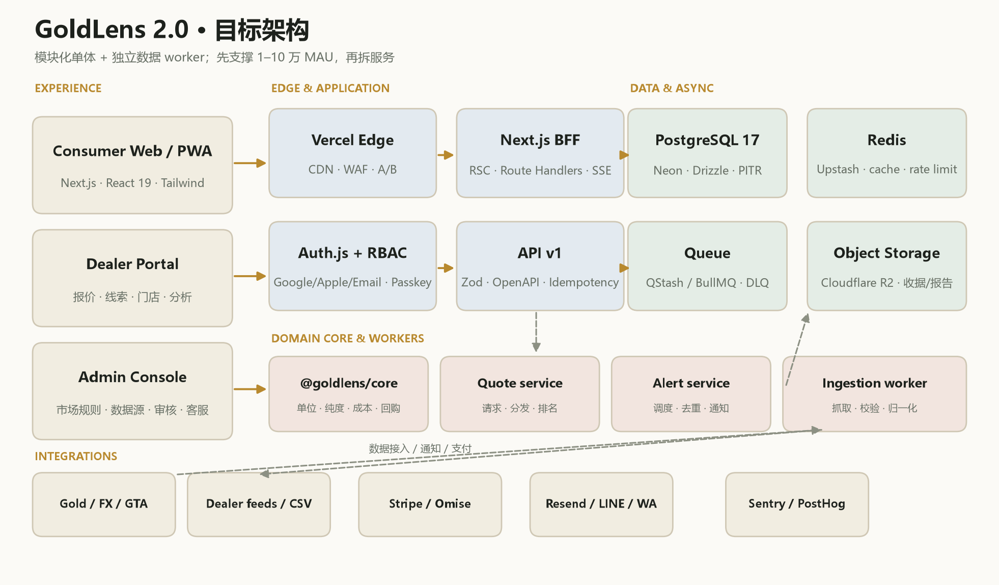
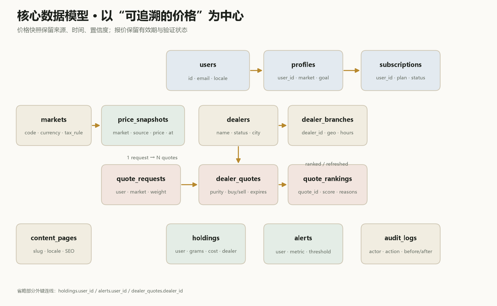
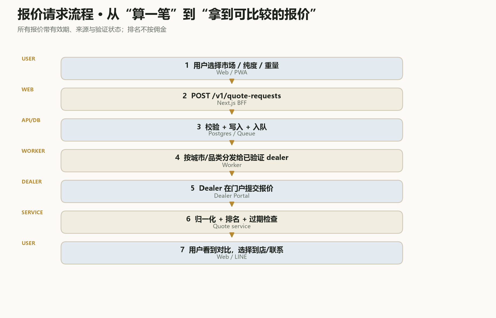
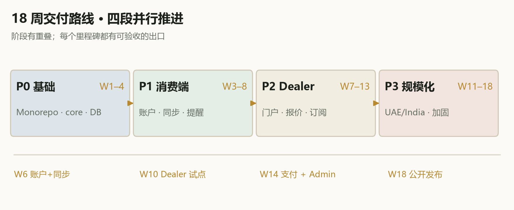

# GoldLens 2.0 技术方案

> 从 MVP 到可用的现代黄金决策平台。

**Version 1.0 · Proposed · 2026-10-23**

---

## 文档地图

- **00** 执行摘要
- **01** 现状与目标
- **02** 产品范围
- **03** 架构原则与选型
- **04** 目标架构
- **05** 技术栈
- **06** 数据架构
- **07** 领域核心
- **08** API 与集成
- **09** 前端与体验
- **10** Dealer 网络
- **11** 账户、同步、提醒与订阅
- **12** 安全、合规与运维
- **13** 测试与发布
- **14** 迁移与路线图
- **A** 附录

---

## 执行摘要
*不是把页面做漂亮，而是把身份、数据、报价网络和运维补齐。*

> **MVP 是一个好用的计算器；GoldLens 2.0 要成为一个可信的决策平台。**

当前 MVP 已经验证了三件事：用户愿意算“到手价—回购价—回本点”；泰国 GTA 的本地数据可以形成差异化；深色黄金视觉和移动端体验能承载“安静的高客单”气质。但它仍然是一个单页工具：没有账户、没有数据库、没有门店报价网络、没有后台、没有支付、没有可观测性。它能在演示里打动人，却不能在真实用户的生活里持续工作。

这份方案给出的不是一次“前端重写”，而是一次有边界的平台化：保留计算引擎、数据降级策略和设计语言；替换运行时、存储、身份、数据层与运营能力；用 18 周、3.5 个 FTE，把 MVP 推进到可公开运营的 V1。

> **本轮结论**  
> 采用“Next.js 模块化单体 + 独立数据 worker + PostgreSQL/Redis/Queue”的架构。先支撑 1–10 万 MAU，不提前拆微服务；把计算引擎抽成纯 TypeScript 包；把价格快照和门店报价做成可追溯的数据资产；把“无托管、无交易、无投资建议”作为产品边界。

### 0.1 六个关键决策

**表 0-1 · 本方案的核心决策**

| 决策 | 选择 | 理由 | 不这样做的代价 |
|---|---|---|---|
| 架构 | 模块化单体 + worker | 团队小、领域耦合强、上线快 | 微服务会先制造运维复杂度 |
| 前端 | Next.js 16 App Router + RSC | SEO、性能、BFF、预览部署一体 | 纯 SPA 会丢失搜索入口与首屏 |
| 数据 | PostgreSQL + Drizzle | 关系、事务、时间序列、可迁移 | Mongo/JSON 会让报价与账目难审计 |
| 领域 | @goldlens/core 纯函数包 | 计算可测试、可复用、可版本化 | 公式散落在 UI 里，迟早算错 |
| 同步 | 本地优先 + 云端账户 | 离线可用、登录不阻塞 | 纯云端会让弱网用户流失 |
| 边界 | 不托管、不交易、不预测 | 降低监管与信任成本 | 一旦碰钱，合规与运营复杂度指数级上升 |

### 0.2 成功度量

**表 0-2 · V1 的六个硬指标**

| 指标 | 定义 | V1 目标 | 观测方式 |
|---|---|---|---|
| 激活率 | 完成一次有效计算 / 新访客 | ≥ 45% | PostHog funnel |
| 比较率 | 查看至少 2 个市场或 2 个报价 / 计算用户 | ≥ 25% | 产品事件 |
| 报价请求 | 提交 quote request / 月活 | ≥ 6% | API + CRM |
| Dealer 响应 | 24h 内有效报价 / 请求 | ≥ 70% | Quote service |
| 订阅转化 | Pro 付费 / 月活 | ≥ 1.5% | Stripe |
| D30 留存 | 30 天内再次查价或持仓 | ≥ 18% |  cohort |

## 01 现状与目标
*先承认 MVP 的边界，才能设计正确的下一步。*

### 1.1 当前 MVP 的真实边界

当前仓库里的 GoldLens 是一个可运行的 Web MVP：单页结构、原生 JavaScript、Node 内置 HTTP 服务、公开数据源、localStorage 持仓与提醒、PWA 与静态 Demo。它的工程质量高于“演示页面”，但离“产品”还差四层。

**表 1-1 · 当前架构**

| 层 | 现状 | 优点 | 限制 |
|---|---|---|---|
| 前端 | 原生 HTML/CSS/JS、SVG 图表、单页 | 加载快、无构建链、视觉可控 | 难做多页面、账户态、复杂交互 |
| 服务端 | Node 24 内置 http、60s 缓存 | 零依赖、部署简单 | 单进程、无队列、无 observability |
| 数据 | gold-api / open.er-api / Yahoo / GTA | 真实、便宜、够用 | 授权、限流、字段变化、无历史归档 |
| 身份 | 无账户 | 零摩擦 | 无法跨设备、无法订阅、无法留存 |
| 存储 | localStorage | 隐私简单、离线可用 | 换设备丢失、无法审计、无法共享 |
| 运营 | 无后台 | 开发快 | 无法审核 dealer、无法客服、无法配置规则 |
| 测试 | smoke + Playwright | 关键路径有覆盖 | 缺单测、契约测试、视觉回归 |

**判断：**保留三样东西：计算口径、数据降级策略、设计语言。

- 计算口径：泰国 96.5% / baht、金料/工费/税/回购/回本点，已经被真实数据验证过。
- 降级策略：单源失败显示“快照”，无后端显示“DEMO”；这是可信产品的基础。
- 设计语言：深色 + 金色 + 衬线标题的“安静奢侈”方向，比通用金融 App 更适合黄金。

### 1.2 从 MVP 到生产级的九个缺口

**表 1-2 · 缺口与优先级**

| 缺口 | 影响 | 优先级 | 本方案对应章节 |
|---|---|---|---|
| 身份与账户 | 不能跨设备、不能订阅、不能做留存 | P0 | 第 11 章 |
| 数据库与审计 | 价格、持仓、报价不可追溯 | P0 | 第 6 章 |
| Dealer 报价网络 | 只有“算”，没有“买得到” | P0 | 第 10 章 |
| 数据质量与授权 | 抓取失败/字段变化会直接误导用户 | P0 | 第 6 / 12 章 |
| 后台与客服 | 无法审核、配置、处理投诉 | P1 | 第 12 章 |
| 支付与订阅 | 没有收入闭环 | P1 | 第 11 章 |
| i18n / RTL | 只能服务中文/英文，难进海湾 | P1 | 第 9 章 |
| 可观测性 | 出问题只能靠用户反馈 | P0 | 第 12 章 |
| 性能与安全 | 公开运营后会被爬、被刷、被攻击 | P0 | 第 12 章 |

> **不要做的事**  
> 不要在第一天做微服务、不要做自研图表库、不要做“AI 预测金价”、不要碰托管与交易。先把“算得清、买得到、留得住”三件事做穿。

### 1.3 目标状态：从工具到平台

**表 1-3 · MVP 与 2.0 的差别**

| 维度 | 当前 MVP | GoldLens 2.0 |
|---|---|---|
| 用户 | 匿名访客 | 账户 + 游客模式 + 跨设备同步 |
| 价值 | 算一次 | 算、比、问、买、跟踪、提醒 |
| 数据 | 公开接口 + 快照 | 多源校验 + 历史归档 + 门店报价 |
| 供给 | 无 | 已验证 dealer + 报价请求 + 线索 |
| 收入 | 无 | 订阅 + 导购 + B2B 白标 |
| 运营 | 无后台 | Admin + Dealer Portal + 客服工具 |
| 质量 | 关键路径测试 | 单测/契约/E2E/视觉/可访问性/压测 |
| 合规 | 免责声明 | 隐私、数据权利、市场规则、审计 |

**定义：**“完全可用”不是功能越多越好，而是用户能在真实网络、真实语言、真实门店环境里完成一条完整路径：发现 → 计算 → 比较 → 询价 → 到店/成交 → 跟踪 → 再次回来。

## 02 产品范围
*V1 只做一条闭环：算清楚、拿到报价、持续跟踪。*

### 2.1 三类核心用户

**表 2-1 · 用户与任务**

| 用户 | 典型场景 | 核心任务 | 成功标准 |
|---|---|---|---|
| 首次买金者 | 旅游/婚嫁/送礼，在曼谷、迪拜、孟买门店 | 不知道单位、工费、税、回购是否合理 | 到店前有一张可给店员看的账单 |
| 攒金/定投者 | 每月 1–10 克，长期持有 | 不知道每次买入溢价、回购价 | 能看到持仓成本与实时回购价值 |
| 以旧换新者 | 旧金饰换新，补工费/差价 | 损耗、折旧、工费叠加，算不清 | 知道换新是否比卖掉再买更划算 |
| 跨境比价者 | 在泰国/阿联酋/印度之间比较 | 单位、纯度、税制不同 | 一张统一口径的跨市场对比 |
| Dealer / 店员 | 获客、报价、跟进 | 线索质量低、解释成本高 | 收到结构化需求，快速给出有效报价 |

### 2.2 V1 的八个模块

**表 2-2 · 模块与优先级**

| 模块 | 内容 | 优先级 | 关键页面 |
|---|---|---|---|
| Discover | 今日金价、市场概览、趋势、内容 | P0 | /, /markets |
| Calculate | 到价计算、工费/税/回购/回本 | P0 | /calculate |
| Compare | 跨市场、跨纯度、跨门店对比 | P0 | /compare |
| Quote | 提交需求、Dealer 报价、排名 | P0 | /quotes |
| Track | 持仓、提醒、历史账单 | P0 | /portfolio, /alerts |
| Learn | 单位、纯度、税制、回购、防坑 | P1 | /learn/[slug] |
| Account | 登录、偏好、订阅、数据权利 | P0 | /account |
| Dealer / Admin | 报价、线索、审核、规则、客服 | P0 | /dealer, /admin |

### 2.3 V1 / V1.5 / V2 的边界

**表 2-3 · 版本边界**

| 版本 | 必须做 | 可以做 | 不做 |
|---|---|---|---|
| V1 | 账户、计算、跨市场、持仓、提醒、3 个市场、Dealer 试点、订阅 | 分享卡、收据上传、LINE 通知 | 交易、托管、KYC、预测 |
| V1.5 | Dealer 排名、报价历史、Admin 规则、UAE/India 本地化 | WhatsApp、OCR 识别、B2B 白标 | 自营金库、杠杆、借贷 |
| V2 | 多语言/RTL、移动端壳、开放 API | 门店库存、预约、保险 | 自营交易平台 |

### 2.4 明确的非目标

- 不做交易撮合、不做资金托管、不做代购、不做金库。
- 不做“金价预测/买卖信号”，不输出个性化投资建议。
- 不做自营金店；Dealer 是独立供给方，平台只做信息与线索。
- 不在 V1 做原生 iOS/Android；先用 PWA 验证留存，再决定移动壳。

### 2.5 成功指标与反指标

**表 2-4 · 指标树**

| 层级 | 指标 | 目标 | 反指标 |
|---|---|---|---|
| 获取 | 自然搜索点击 / 月 | ≥ 30k | 只靠投放，SEO 无增长 |
| 激活 | 计算完成率 | ≥ 45% | 页面很炫但没人算完 |
| 价值 | 报价请求率 | ≥ 6% | 只看看，不询价 |
| 供给 | Dealer 24h 响应率 | ≥ 70% | 大量无效线索 |
| 留存 | D30 回访 | ≥ 18% | 只有金价大涨才回来 |
| 收入 | Pro 转化 | ≥ 1.5% | 订阅权益与免费版无差异 |

## 03 架构原则与选型
*为 1–10 万 MAU 设计，不为“以后可能”过度设计。*

### 3.1 七条原则

- 模块化单体优先：一个部署单元、一个数据库、清晰的模块边界；等团队和流量真的需要，再拆。
- 领域核心纯函数化：单位、纯度、税、工费、回购、回本点不依赖 React、不依赖数据库。
- 数据可追溯：每条价格/报价都有来源、时间、置信度、版本；不许“拍脑袋覆盖”。
- 优雅降级：单源失败显示快照；无后端显示 DEMO；写操作失败可重试、可回滚。
- 本地优先：弱网/离线也能计算和查看持仓；登录后增量同步。
- 安全默认：最小权限、服务端校验、限流、审计、隐私最小化。
- 体验即基础设施：性能预算、可访问性、i18n、SEO 不是“上线后再补”。

### 3.2 为什么是模块化单体

GoldLens 的领域边界很清楚：价格、计算、报价、持仓、提醒、订阅。它们共享同一套用户、市场、纯度、单位与权限模型，强耦合、低独立部署价值。过早拆成 6 个服务，只会把“一个事务”变成“六个分布式事务”。

**表 3-1 · 单体 vs 微服务**

| 维度 | 模块化单体（推荐） | 微服务 |
|---|---|---|
| 交付速度 | 一个 PR、一次部署 | 多仓库/多流水线 |
| 事务 | 数据库事务直接保证 | Saga/补偿，复杂 |
| 调试 | 一个日志链路 | 跨服务追踪 |
| 团队 | 3–6 人最合适 | 需要平台团队 |
| 扩展 | 按模块水平扩展；worker 独立 | 按服务扩展，成本更高 |
| 何时切换 | >30 人、>100 万 MAU、模块独立扩容 | 现在就拆是负优化 |

### 3.3 技术选型决策

**表 3-2 · 选型与替代方案**

| 层 | 选择 | 为什么 | 替代 |
|---|---|---|---|
| Web | Next.js 16 App Router + React 19 | SEO/ISR、RSC、BFF、Vercel 预览 | SvelteKit / Remix |
| 语言 | TypeScript strict | 前后端共享类型与校验 | JS + JSDoc |
| 样式 | Tailwind CSS v4 + shadcn/ui | 设计系统快、可访问性基线好 | CSS Modules / Mantine |
| API | Next Route Handlers + Zod/OpenAPI | 少一个服务、契约清晰 | Fastify / NestJS |
| 数据库 | PostgreSQL 17 + Drizzle | 事务、关系、时间序列、SQL 可控 | MySQL / MongoDB |
| 缓存/队列 | Redis + QStash/BullMQ | 价格缓存、限流、异步报价 | SQS / RabbitMQ |
| 认证 | Auth.js v5 | 自托管、多 provider、可控 | Clerk / Supabase Auth |
| 支付 | Stripe + Omise（泰国） | 订阅/发票/本地支付 | Paddle / 自建 |
| 部署 | Vercel + Fly.io worker | 前端边缘、worker 长任务 | AWS / Cloudflare |

### 3.4 容量假设

**表 3-3 · 容量与 SLO 基线**

| 维度 | 6 个月 | 12 个月 | 设计含义 |
|---|---|---|---|
| MAU | 10k | 100k | 单区域多可用区即可 |
| 峰值请求 | 20 req/s | 150 req/s | CDN + Redis 抗读 |
| 价格快照 | ~2k/天 | ~20k/天 | 按月分区，保留 24 个月 |
| Dealer 报价 | ~500/天 | ~10k/天 | 写多读多，需索引与过期清理 |
| API p95 | <300ms（缓存） | <300ms（缓存） | <800ms（未缓存） |
| 可用性 | 99.5% | 99.9% | 错误预算 + 告警 |

### 3.5 架构决策记录（ADR）

**表 3-4 · ADR 摘要**

| ADR | 决策 | 状态 |
|---|---|---|
| ADR-001 | 模块化单体，worker 独立部署 | Accepted |
| ADR-002 | Next.js App Router 作为 Web/BFF | Accepted |
| ADR-003 | PostgreSQL 作为唯一事实源 | Accepted |
| ADR-004 | 克/纯度/币种为规范单位，金额用 decimal | Accepted |
| ADR-005 | 不托管、不交易、不预测 | Accepted |
| ADR-006 | 本地优先 + 云端增量同步 | Accepted |
| ADR-007 | 报价排名不按佣金，按可解释因子 | Accepted |

## 04 目标架构
*一个前端、一个 BFF、一个 worker、一个数据库。*

下图是 V1 的目标架构。Experience 层是三个表面：消费者 Web/PWA、Dealer Portal、Admin Console；Edge & Application 层由 Vercel Edge + Next.js BFF 承担；Domain Core 是纯计算与规则；Data & Async 负责持久化、缓存、队列和对象存储；Integrations 对接行情、门店、支付与通知。



*图 4-1 · GoldLens 2.0 目标架构：模块化单体 + 独立数据 worker。*

### 4.1 分层职责

**表 4-1 · 架构分层**

| 层 | 职责 | 不做什么 |
|---|---|---|
| Experience | 页面、设计系统、表单、状态、PWA、分享卡 | 不直接连数据库、不写业务规则 |
| Edge / BFF | 鉴权、限流、参数校验、聚合、SSE、缓存头 | 不承载长时间任务 |
| Domain Core | 单位/纯度/税/工费/回购/回本/排名规则 | 不依赖 React/DB/网络 |
| Data & Async | Postgres、Redis、队列、对象存储、备份 | 不写业务逻辑 |
| Integrations | 行情、FX、GTA、Dealer、Stripe、通知、观测 | 不让第三方 schema 泄漏到核心 |

### 4.2 运行时拓扑

**表 4-2 · 运行时与供应商**

| 组件 | 运行位置 | 职责 | 故障策略 |
|---|---|---|---|
| Web/BFF | Vercel（新加坡/法兰克福） | RSC、API、SSE、预览环境 | 多区域静态回退 + 快照 |
| Worker | Fly.io / Render | 行情抓取、报价分发、提醒 | 重试 + DLQ + 告警 |
| Postgres | Neon / Supabase | 事实源、PITR、只读副本 | 连接池 + 只读降级 |
| Redis | Upstash | 缓存、限流、幂等键 | 失败时降级到 DB |
| Queue | QStash / BullMQ | 报价请求、通知、重算 | 指数退避 + 死信 |
| R2 | Cloudflare | 收据、报价单、导出 | 签名 URL + 生命周期 |

### 4.3 Monorepo 结构

```text
goldlens/
├── apps/
│   ├── web/                 # Next.js 16：消费者 + Dealer + Admin
│   └── worker/              # 行情抓取、报价分发、提醒
├── packages/
│   ├── core/                # 纯计算、单位、规则、排名
│   ├── db/                  # Drizzle schema、迁移、seed
│   ├── ui/                  # 设计系统、shadcn 封装
│   ├── config/              # 环境、常量、feature flags
│   └── i18n/                # 文案、格式化、RTL
├── infra/                   # IaC、监控、备份脚本
├── docs/                    # 本方案、ADR、runbook
└── tests/                   # 契约、E2E、视觉、压测
```

### 4.4 环境与发布单元

**表 4-3 · 环境**

| 环境 | 数据 | 用途 | 访问 |
|---|---|---|---|
| local | seed + 公开快照 | 开发/单测 | 开发者 |
| preview | 每次 PR 独立 DB schema | 设计/验收/自动 E2E | 团队 + 客户 |
| staging | 脱敏副本 | 上线前回归/压测 | 团队 |
| production | 真实数据 | 公开运营 | 全员 + 审计 |

### 4.5 三条关键请求路径

1. 读价格：CDN → Edge → BFF → Redis（命中）→ 返回；未命中查 Postgres 最近快照，再异步刷新。
2. 算账单：BFF 校验参数 → core 纯函数计算 → 返回 breakdown；不写库、不需要登录。
3. 发报价：BFF 写 quote_request + 入队 → worker 分发给 dealer → dealer 提交 → 归一化/排名 → 用户看到对比。

## 05 技术栈
*用一套类型系统，把前端、BFF、worker 和数据库连起来。*

### 5.1 前端

**表 5-1 · 前端栈**

| 能力 | 选择 | 用途 | 注意 |
|---|---|---|---|
| 框架 | Next.js 16 App Router | RSC、路由、ISR、BFF | 避免把全部页面做成 client component |
| UI | React 19 + TypeScript strict | 组件、并发、类型安全 | 禁止 any 进入 core |
| 样式 | Tailwind CSS v4 + CSS variables | 设计 token、暗/亮主题 | 不要散落 magic color |
| 组件 | shadcn/ui + Radix | Dialog、Select、Tabs、Toast | 二次封装成 GoldLens primitives |
| 数据 | TanStack Query | 客户端缓存、重试、乐观更新 | 价格用 SSE 推送，不轮询 |
| 表单 | React Hook Form + Zod | 计算器/报价/登录表单 | 前后端共用 schema |
| 图表 | Recharts / visx | 价格、成本瀑布、区间 | 首屏不加载大图表库 |
| 动效 | Motion | 页面转场、数字滚动 | 尊重 prefers-reduced-motion |
| 国际化 | next-intl | zh/en/th/ar、RTL | 文案不写在组件里 |
| PWA | Serwist | 离线 shell、安装、缓存策略 | API 不做 cache-first |

### 5.2 后端与数据

**表 5-2 · 后端栈**

| 能力 | 选择 | 用途 |
|---|---|---|
| API/BFF | Next.js Route Handlers | REST v1、SSE、webhook、文件签名 |
| 校验 | Zod + OpenAPI | 请求/响应契约、SDK 生成 |
| ORM | Drizzle ORM + drizzle-kit | 类型安全 SQL、迁移、seed |
| 数据库 | PostgreSQL 17（Neon） | 事实源、分区、PITR、只读副本 |
| 缓存 | Upstash Redis | 价格缓存、限流、幂等键、会话 |
| 队列 | QStash / BullMQ | 报价分发、提醒、重算、导出 |
| 对象存储 | Cloudflare R2 | 收据、报价单、导出、图片 |
| Worker | Node 24 + TypeScript | 抓取、归一化、通知、排名 |

### 5.3 认证、支付与通知

**表 5-3 · 外部能力**

| 能力 | 选择 | 首期范围 | 后续 |
|---|---|---|---|
| 认证 | Auth.js v5 | Google/Apple/Email magic link | Phone OTP、Passkey |
| 订阅 | Stripe Billing | Pro 月/年付、发票、webhook | 本地支付方式 |
| 泰国支付 | Omise / Stripe | PromptPay、卡 | TrueMoney |
| 邮件 | Resend | 登录、提醒、收据 | 模板本地化 |
| 推送 | Web Push（VAPID） | 价格提醒 | iOS PWA 限制处理 |
| 即时消息 | LINE Messaging API | 泰国提醒/分享 | WhatsApp Cloud API |
| 客服 | Intercom / Crisp | 帮助中心、工单 | Dealer 专属 SLA |

### 5.4 可观测性与分析

**表 5-4 · 观测栈**

| 层 | 工具 | 用途 |
|---|---|---|
| 错误 | Sentry | 前端/后端异常、release 关联 |
| 指标/追踪 | OpenTelemetry + Axiom/Grafana | p95、错误率、队列积压 |
| 合成监控 | Checkly | 关键路径每分钟探测 |
| 产品分析 | PostHog | 漏斗、cohort、实验 |
| 日志 | 结构化 JSON + trace_id | 请求链路、审计 |
| 告警 | PagerDuty / Slack | SLO 燃烧率、数据源失败 |

### 5.5 工程工具

- 包管理：pnpm + Turborepo；锁文件提交，CI 使用 frozen lockfile。
- 代码质量：TypeScript strict、Biome（lint+format）、import 边界规则。
- 测试：Vitest、Testing Library、Playwright、axe、k6。
- 提交：Conventional Commits、Changesets、release-please。
- 安全：Dependabot、CodeQL、secret scanning、npm audit（仅阻断 high）。
- 文档：ADR、OpenAPI、Storybook、runbook。

### 5.6 版本与升级策略

每季度一次依赖升级窗口；Next.js/React/Postgres 只升一个 major，先在 preview 跑 1 周。所有第三方 SDK 用适配器隔离，避免供应商锁定。Node 版本固定在 24 LTS，CI 与生产一致。

## 06 数据架构
*价格不是一条记录，而是一条有来源、有时间的证据链。*

GoldLens 的数据模型以“可追溯的价格”为中心：价格快照保留来源、抓取时间、置信度；门店报价保留有效期、验证状态与排名理由；用户持仓保留成本、来源与收据。所有金额、重量、纯度都有规范单位，展示层再做本地化。



*图 6-1 · 核心数据模型：用户、市场、价格快照、门店报价、持仓、提醒与审计。*

### 6.1 规范单位与金额

**表 6-1 · 数据规范**

| 字段 | 规范 | 示例 | 禁止 |
|---|---|---|---|
| 重量 | weight_g numeric(18,6)，克 | 15.244000 | 在 DB 存 baht/tola |
| 纯度 | purity numeric(6,5)，0–1 | 0.96500 | 存 “96.5%” 字符串 |
| 金额 | amount_minor bigint + currency | 6500000 THB minor | float/double |
| 价格 | price numeric(18,6) + quote_currency | 4024.10 USD/oz | 混用盎司/克 |
| 时间 | timestamptz，UTC | 2026-10-23T05:11:00Z | 本地时间无时区 |
| 单位 | unit enum: g / baht / tola / oz | baht | 前端自由字符串 |

### 6.2 核心表

**表 6-2 · 核心表与关键字段**

| 表 | 作用 | 关键字段 | 索引/约束 |
|---|---|---|---|
| users | 账户 | id, email, locale, created_at | unique(email) |
| profiles | 偏好 | user_id, market, goal, units | unique(user_id) |
| markets | 市场规则 | code, currency, tax_rule, active | unique(code) |
| price_snapshots | 价格快照 | market, source, price, unit, observed_at, confidence | (market, observed_at desc) |
| dealers | 经销商 | name, status, city, verified_at | index(city, status) |
| dealer_branches | 门店 | dealer_id, geo, hours | gist(geo) |
| dealer_quotes | 门店报价 | dealer_id, purity, buy/sell, making, tax, expires_at | (dealer_id, expires_at) |
| quote_requests | 用户询价 | user_id, market, weight_g, purity, status | (user_id, created_at) |
| quote_rankings | 排名快照 | quote_id, score, reasons | unique(quote_id) |
| holdings | 持仓 | user_id, grams, purity, cost_minor, dealer_id | (user_id) |
| alerts | 提醒 | user_id, metric, comparator, threshold, channels | (user_id, status) |
| subscriptions | 订阅 | user_id, plan, status, period_end | (user_id, status) |
| audit_logs | 审计 | actor, action, entity, before/after | (entity, created_at) |

### 6.3 价格快照

价格快照是 append-only 的。每次抓取写一条，不做 update；对外只读“最新有效快照”。这样可以回溯“当时为什么算出这个价”，也可以做数据质量分析。

```text
price_snapshots
  id              uuid pk
  market_code     text fk markets.code
  source          text            -- gold-api / gta / dealer_x
  source_url      text
  kind            text            -- spot / local_bar / local_ornament / fx
  price           numeric(18,6)
  currency        char(3)
  unit            text            -- oz / g / baht / tola
  purity          numeric(6,5)
  observed_at     timestamptz
  ingested_at     timestamptz
  confidence      numeric(4,3)    -- 0–1
  raw_payload     jsonb
  checksum        text
  created_at      timestamptz default now()
```

### 6.4 门店报价

门店报价不是“价格表”，而是一份有有效期的商业要约。每条报价必须能回答：谁报的、什么时候有效、含不含工费/税、回购价是多少、是否验证过。

```text
dealer_quotes
  id              uuid pk
  dealer_id       uuid fk dealers.id
  branch_id       uuid fk dealer_branches.id
  market_code     text
  product_type    text            -- bar / jewelry / coin
  purity          numeric(6,5)
  weight_g        numeric(18,6)
  sell_price_minor bigint
  buyback_minor   bigint
  making_charge_bps integer       -- 基点，避免浮点
  tax_bps         integer
  currency        char(3)
  effective_at    timestamptz
  expires_at      timestamptz
  verification    text            -- self_reported / verified / audited
  source          text            -- portal / csv / api
  notes           text
```

### 6.5 数据接入管线

1. Scheduler：spot 每 60 秒，FX 每小时，GTA 每 5 分钟，Dealer feed 每 15 分钟；全部带 jitter。
2. Fetch：每个 source 独立 adapter，统一输出 RawPrice；超时 8 秒、重试 3 次、指数退避。
3. Normalize：单位/纯度/币种归一化到克、0–1、ISO 货币；记录原始 payload 与 checksum。
4. Validate：非空、正数、时间新鲜、跨源偏差、异常跳变；不通过进 quarantine。
5. Persist：append-only 写 price_snapshots；冲突用 (source, observed_at) 幂等。
6. Publish：刷新 Redis、发事件、更新 SSE；失败重试 + DLQ。
7. Observe：source health、freshness、outlier rate、DLQ 深度进仪表盘。

### 6.6 新鲜度与数据质量

**表 6-3 · 数据 SLO**

| 数据 | 目标新鲜度 | 告警阈值 | 降级 |
|---|---|---|---|
| XAU/USD spot | < 60s | > 3min | 显示最近快照 + “延迟” |
| USD/THB / AED / INR | < 2h | > 12h | 使用上一日中间价 |
| GTA 泰国 | < 10min | > 30min | 显示“GTA 快照” |
| Dealer 报价 | < 24h | > 48h | 标记过期，不参与排名 |
| 历史日线 | 每日 1 次 | 缺 2 天 | 使用缓存，标注 |

- 异常跳变：5 分钟内 > 8% 的价格变动需要二次源确认，否则只记录不对外。
- 跨源偏差：spot 与 GTA 折算价偏差 > 3% 时，前端显示“数据分歧”，不选一个假装正确。
- 缺失值：不允许用 0 或上一日价格静默填充；必须标记 `stale` 与 `source`。

### 6.7 缓存、分区与保留

**表 6-4 · 缓存与保留**

| 对象 | 策略 | TTL | 说明 |
|---|---|---|---|
| market:latest:{market} | Redis string | 60s | 最新快照 JSON |
| fx:latest | Redis hash | 1h | 币种表 |
| quote:{id} | Redis string | 5min | 报价详情 |
| rate:{ip}:{route} | Redis counter | 60s | 限流 |
| price_snapshots | 按月分区 | 24 个月 | 归档到 R2 |
| audit_logs | 按季度分区 | 7 年 | 合规/审计 |
| receipts | R2 生命周期 | 7 年 | 用户可删除 |

> **数据原则**  
> 宁可显示“快照/延迟/分歧”，也不要显示一个看起来精确、实际错误的数字。黄金是钱，信任只有一次。

## 07 领域核心
*把“算得对”从 UI 里拿出来，变成可测试的资产。*

### 7.1 @goldlens/core 的边界

```text
packages/core/
├── units.ts          # g / baht / tola / oz 转换
├── purity.ts         # 24K / 22K / 18K / 96.5%
├── money.ts          # Decimal 运算、舍入、币种
├── quote.ts          # 到手价、工费、税、回购、回本
├── ranking.ts        # dealer quote 排名
├── rules/
│   ├── th.ts         # 泰国 96.5% / GTA
│   ├── ae.ts         # 阿联酋 22K / VAT
│   ├── in.ts         # 印度 22K / GST
│   └── us.ts         # 美国 24K
└── index.ts
```

### 7.2 计算口径

```text
金料价值 = 金价(USD/oz) ÷ 31.1034768 × 汇率 × 克重 × 纯度
到手价   = 金料价值 + 工费/溢价 + 税费
即时回购 = 本地回购价 × 重量（或 金料价值 × (1 − 回购折价)）
回本涨幅 = 到手价 ÷ 即时回购 − 1
```

实现上使用 decimal.js（或 big.js），禁止 JavaScript float 直接做金额。所有中间结果保留 6 位小数，最终按币种最小单位舍入；舍入规则显式写在 rules 里，并在测试中锁定。

### 7.3 市场规则配置

```text
{
  "market": "TH",
  "currency": "THB",
  "purityDefault": 0.965,
  "unitDefault": "baht",
  "tax": { "type": "none", "bps": 0 },
  "making": { "mode": "gta_implied", "defaultBps": 0 },
  "buyback": { "mode": "gta_ornament", "spreadBps": 350 },
  "fairness": { "lowBps": 200, "midBps": 500, "highBps": 1000 },
  "disclaimerKey": "th.gold.reference"
}
```

规则是版本化的：`rules/th@2026-10.json`；每次修改都要有生效日期、变更原因、测试向量。计算结果里带 `rule_version`，便于审计与回放。

### 7.4 测试向量

**表 7-1 · 核心测试向量（2026-10-23 12:11 GTA）**

| 用例 | 输入 | 期望 | 说明 |
|---|---|---|---|
| 泰国金饰 | 1 baht, 96.5%, GTA ornament | 65,000 THB | 到手价锚 |
| 泰国回购 | 1 baht, 96.5%, GTA buy | 62,716.92 THB | 回购价 |
| 泰国隐形成本 | 标价 − 回购 | 2,283.08 THB / 3.5% | 一买一卖 |
| 泰国回本 | 65,000 / 62,716.92 − 1 | 3.64% | 金价需上涨 |
| 阿联酋 | 1g, 22K, AED, making 12%, VAT 5% | ≈ AED 512 | 估算 |
| 印度 | 10g, 24K, INR, making 12%, GST 3% | ≈ ₹141,523 | 估算 |
| 单位 | 1 baht | 15.244 g | 规范转换 |
| 单位 | 1 tola | 11.6638125 g | 规范转换 |

### 7.5 边界情况

- 重量为 0 / 负数 / 超过 1000g：拒绝，返回 `VALIDATION_ERROR`。
- 纯度不在支持列表：拒绝；不要“四舍五入到 22K”。
- 报价过期：不参与排名，前端标“已过期”。
- 回购价为 0：显示“暂无回购价”，不回退到金料价。
- 汇率缺失：整笔计算不可用，显示“汇率暂不可用”，不猜。
- 舍入：先按最小单位四舍五入，再展示；避免 0.01 的累计误差。

### 7.6 排名算法（可解释）

Dealer 报价排名不按佣金。V1 使用五项加权：到手价 40%、回购价 25%、距离/便利 15%、验证等级 10%、新鲜度 10%。每项归一化到 0–100，输出 `score` 与 `reasons`，前端展示“为什么排第一”。

```text
score = 0.40 * priceScore
      + 0.25 * buybackScore
      + 0.15 * proximityScore
      + 0.10 * verificationScore
      + 0.10 * freshnessScore
// priceScore = 100 * (maxAllIn - quoteAllIn) / (maxAllIn - minAllIn)
```

付费推广只能出现在明确标注的“赞助”位，不改变自然排名。这条规则写进 Dealer 合同与 Admin 审计。

## 08 API 与集成
*前后端共用一份契约，第三方永远隔在 adapter 后面。*

### 8.1 API 原则

- REST/JSON，版本前缀 `/api/v1`；破坏性变更升 v2，不静默改字段。
- Zod 定义请求/响应，生成 OpenAPI 与 TypeScript SDK。
- 统一错误 envelope：`{ error: { code, message, requestId, details } }`。
- 所有写操作支持 `Idempotency-Key`；报价/提醒/支付 webhook 必须幂等。
- 读接口用 ETag + `Cache-Control`；价格读走 SSE，不轮询。
- 服务端永远重新计算价格/权限，不信任前端传来的金额。

### 8.2 核心端点

**表 8-1 · API v1**

| 方法 | 路径 | 鉴权 | 用途 |
|---|---|---|---|
| GET | /api/v1/market/overview | public | 市场、spot、FX、GTA、更新时间 |
| GET | /api/v1/market/history | public | 30D/90D/1Y 日线 |
| POST | /api/v1/quote/calculate | public | 纯计算，不落库 |
| GET | /api/v1/dealers | public | 按城市/纯度/重量筛选 |
| POST | /api/v1/quote-requests | user | 提交询价 |
| GET | /api/v1/quote-requests/:id | user | 查看报价与排名 |
| POST | /api/v1/dealer/quotes | dealer | Dealer 提交报价 |
| GET/POST | /api/v1/holdings | user | 持仓 CRUD |
| GET/POST | /api/v1/alerts | user | 提醒 CRUD |
| POST | /api/v1/billing/checkout | user | Stripe Checkout |
| POST | /api/v1/webhooks/stripe | signature | 订阅事件 |
| GET | /api/v1/events/prices | public | SSE 价格流 |

### 8.3 计算请求示例

```text
POST /api/v1/quote/calculate
{
  "market": "TH",
  "purity": 0.965,
  "weight": 1,
  "unit": "baht",
  "makingBps": 0,
  "taxBps": 0
}

200 OK
{
  "input": { "...": "..." },
  "money": {
    "currency": "THB",
    "metalMinor": 6420000,
    "makingMinor": 80000,
    "taxMinor": 0,
    "totalMinor": 6500000,
    "buybackMinor": 6271692
  },
  "percent": {
    "premiumBps": 135,
    "instantLossBps": 351,
    "breakEvenBps": 364
  },
  "provenance": {
    "spotSource": "gold-api.com",
    "localSource": "GTA",
    "observedAt": "2026-10-23T05:11:00Z",
    "ruleVersion": "th@2026-10"
  }
}
```

### 8.4 实时价格：SSE 而不是轮询

`GET /api/v1/events/prices?market=TH` 返回 `text/event-stream`，每 30 秒或价格变化时推送 `market.tick`。BFF 从 Redis 读最新快照；连接断开自动重连；页面隐藏时降频。SSE 比 WebSocket 简单，足够覆盖价格看板。

### 8.5 Webhook 与外部集成

**表 8-2 · 集成边界**

| 集成 | 方向 | 安全 | 失败处理 |
|---|---|---|---|
| Stripe | 入站 webhook | 签名校验 + 重放保护 | 幂等 + 重试 |
| LINE / WhatsApp | 出站 | token 轮换 | 队列重试 + 降级邮件 |
| Dealer CSV/API | 入站 | 签名/白名单 + 字段校验 | 隔离 + 人工审核 |
| GTA | 入站抓取 | 限频 + UA + 缓存 | 快照 + 告警 |
| Gold/FX | 入站 API | key + timeout | 快照 + 降级 |

### 8.6 限流、幂等与错误码

**表 8-3 · 错误码**

| HTTP | code | 场景 | 前端动作 |
|---|---|---|---|
| 400 | VALIDATION_ERROR | 参数不合法 | 字段级提示 |
| 401 | AUTH_REQUIRED | 未登录 | 打开登录 |
| 402 | ENTITLEMENT_REQUIRED | Pro 权益 | 展示升级 |
| 404 | MARKET_UNSUPPORTED | 市场未开放 | 切换市场 |
| 409 | QUOTE_EXPIRED | 报价过期 | 刷新报价 |
| 429 | RATE_LIMITED | 限流 | 退避 + 提示 |
| 503 | UPSTREAM_UNAVAILABLE | 数据源/支付不可用 | 显示快照/重试 |

## 09 前端与体验
*把“贵金属”做成“安静的信任”，不是“金色的喧嚣”。*

### 9.1 设计方向

关键词：安静、克制、可读、有触感。80% 中性色（墨黑/米白/石灰），20% 金色只用于价格、关键动作和状态；数据用无衬线，叙事用衬线；动效只用于解释变化，不用于装饰。

- 视觉：深色为默认，提供浅色；金色是“证据”，不是背景。
- 排版：大数字用 tabular-nums；单位、币种、更新时间永远紧跟数字。
- 信息：先给结论，再给拆解；先给“到手价/回购价”，再给公式。
- 语气：不承诺、不恐吓、不喊单；用“参考/估算/以门店为准”。

### 9.2 设计 token

**表 9-1 · 设计 token（节选）**

| Token | 值 | 用途 |
|---|---|---|
| --bg | #0A0C0B | 页面背景 |
| --surface | #121512 | 卡片 |
| --ink | #F4F0E6 | 主文字 |
| --muted | #A9A99C | 次文字 |
| --gold | #E5C46B | 价格/主 CTA |
| --positive | #8FBD9A | 上涨/正向 |
| --negative | #D98D7C | 下跌/风险 |
| --radius-lg | 22px | 卡片 |
| --shadow | 0 30px 80px rgba(0,0,0,.35) | 浮层 |

### 9.3 信息架构

```text
/                         今日金价 + 快速计算 + 市场脉搏
/calculate                真实成本计算器
/compare                  跨市场 / 跨纯度 / 跨门店
/quotes                   询价与报价对比
/dealers/[city]           门店目录与详情
/portfolio                持仓与盈亏
/alerts                   价格提醒
/learn/[slug]             单位/纯度/税/回购/防坑
/account                  偏好/订阅/数据权利
/dealer/*                 Dealer Portal
/admin/*                  Admin Console
```

### 9.4 页面规格

**表 9-2 · 关键页面**

| 页面 | 主任务 | 核心组件 | 成功事件 |
|---|---|---|---|
| Home | 30 秒内理解“今天买金贵不贵” | 价格头图、市场切换、迷你计算器、趋势 | start_calc |
| Calculate | 算出到手价/回购/回本 | 市场/纯度/重量、成本瀑布、结果卡 | calc_complete |
| Compare | 同口径比较 | 对比表、价差、到店 CTA | compare_view |
| Quotes | 拿到可比较报价 | 需求表单、报价卡、排名理由 | quote_request |
| Portfolio | 知道手里的金值多少 | 汇总、持仓表、回购估值 | holding_add |
| Alerts | 不用一直刷 | 目标价、渠道、触发历史 | alert_create |
| Learn | 建立信任/SEO | 长文、FAQ、结构化数据 | learn_read |
| Account | 偏好/订阅/数据 | 登录、语言、货币、导出/删除 | subscription_start |

### 9.5 组件与状态

- Primitives：Button、Input、Select、Tabs、Dialog、Sheet、Toast、Tooltip、Skeleton。
- Domain：PriceTicker、MarketSwitcher、CostWaterfall、BuybackCard、QuoteCard、HoldingRow。
- 状态：loading（骨架）、empty（解释 + 下一步）、error（可重试）、offline（本地数据）、stale（时间戳）。
- 乐观更新：持仓/提醒先本地写入，失败回滚并提示。

### 9.6 移动端与 PWA

移动端是主战场：底部导航（首页/计算/对比/持仓/我的），计算器单列，结果卡 sticky；安装引导在第二次访问后出现；分享卡生成 1080×1350 的“标价 vs 回购”图。PWA 缓存 shell 与最近市场快照，离线可计算、可看持仓。

### 9.7 可访问性与性能预算

**表 9-3 · 体验预算**

| 维度 | 目标 | 验证 |
|---|---|---|
| LCP | < 2.5s（4G） | Lighthouse CI |
| INP | < 200ms | RUM + Playwright |
| CLS | < 0.1 | Lighthouse |
| JS（首屏） | < 180KB gzip | bundle analyzer |
| 可访问性 | WCAG 2.2 AA | axe + 手动键盘 |
| 对比度 | ≥ 4.5:1 | token 审查 |
| 减少动效 | prefers-reduced-motion | E2E |

### 9.8 SEO、i18n 与内容

- 程序化落地页：市场 × 纯度 × 单位 × 场景（如 `/th/gold-price-22k-per-gram`）。
- JSON-LD：FAQPage、Product/Offer（仅对真实报价）、BreadcrumbList。
- hreflang：zh-CN / en / th / ar；RTL 从 day 1 用 logical properties。
- 内容：单位解释、工费谈判、回购折价、以旧换新、旅游买金防坑。
- 每页必须有：来源、更新时间、免责声明、最后审核人。

### 9.9 分析事件

**表 9-4 · 事件 schema（节选）**

| 事件 | 属性 | 用途 |
|---|---|---|
| market_view | market, source | 市场偏好 |
| calc_complete | market, purity, unit, total, premium_bps | 激活/定价 |
| compare_view | markets, spread_bps | 比较价值 |
| quote_request | market, weight, purity, dealers | 供给需求 |
| holding_add | market, grams, cost | 留存 |
| alert_create | metric, threshold, channel | 订阅意向 |
| subscription_start | plan, market, trial | 收入 |

## 10 Dealer 网络
*从“算得清”到“买得到”，这是 2.0 的真正分水岭。*

没有 Dealer，GoldLens 只是一个更漂亮的计算器；有了 Dealer，用户才能在“算清楚”之后拿到可比较的报价。V1 不追求全国覆盖，先在曼谷/清迈选 10–20 家独立金店，把“提交需求 → 24h 内 3 条有效报价 → 到店”跑通。



*图 10-1 · 报价请求流程：需求结构化、分发给已验证 Dealer、归一化后排名。*

### 10.1 Dealer 入驻与验证

**表 10-1 · Dealer 生命周期**

| 阶段 | 动作 | 系统 | 人工 |
|---|---|---|---|
| 申请 | 营业执照、门店照片、联系人、品类 | Portal 表单 + 文件上传 | 初审 |
| 验证 | 电话/视频/实地（抽样） | Admin 工单 | 运营 |
| 上架 | 门店、营业时间、支持品类 | Admin 审核 | 运营 |
| 报价 | 收到 request 后 24h 内提交 | Portal / CSV / API | 异常复核 |
| 评级 | 响应率、过期率、投诉率 | 自动 | 季度复核 |
| 退出 | 下架、历史报价保留 | Admin | 运营 |

### 10.2 报价请求的生命周期

1. `draft`：用户填写市场、品类、纯度、重量、城市、期望时间。
2. `submitted`：校验 + 去重 + 风控；写入 DB，入队。
3. `dispatched`：按城市/品类/验证等级分发给 3–8 家 Dealer。
4. `quoted`：至少 1 条有效报价；过期报价自动剔除。
5. `ranked`：归一化 + 排名 + 理由；用户可见。
6. `connected`：用户选择到店/联系；生成 lead，记录归因。
7. `closed`：成交/流失/过期；7 天后匿名化。

### 10.3 排名与展示

排名公式见 7.6。前端必须同时展示：到手价、回购价、价差、有效期、验证等级、距离/营业时间、排名理由。不允许只显示“最低价”而隐藏回购价；不允许把赞助位混进自然排名。

### 10.4 反滥用

**表 10-2 · 滥用与防护**

| 风险 | 表现 | 防护 |
|---|---|---|
| 假询价 | 竞对刷需求/套价 | 手机验证、频率限制、设备指纹、人工抽检 |
| 假报价 | 低价引流、到店加价 | 报价有效期、验证等级、投诉扣分、下架 |
| 刷排名 | 虚假验证/刷响应率 | 服务端计算、审计日志、季度复核 |
| 隐私泄露 | 用户手机号被滥用 | 虚拟号/脱敏、最小化字段、访问审计 |
| 刷单 | 伪造 lead 成交 | 归因链接、门店确认、抽样回访 |

### 10.5 商业模式

**表 10-3 · Dealer 侧收入**

| 模式 | 定价 | 适用 | 风险 |
|---|---|---|---|
| Lead fee | 每条有效 lead 50–200 THB | 试点期 | 线索质量争议 |
| 成交佣金 | 成交额 0.5%–1.5% | 规模期 | 归因/跳单 |
| SaaS 订阅 | 1,500–5,000 THB/月 | 连锁/多门店 | 销售周期 |
| 白标计算器 | 3,000–15,000 THB/月 | 旅游平台/金店 | 定制成本 |

### 10.6 冷启动打法

- 先做“到店前检查”而不是“成交承诺”：降低 Dealer 戒心，先给高质量到店客户。
- 选 10 家独立店，覆盖 3 个游客/外派聚集区；每家给专属二维码/落地页。
- 用真实 GTA 数据做每日内容，吸引搜索流量，再把高意向用户导入询价。
- 前 100 条 lead 人工跟进，记录“报价→到店→成交”全链路，校准排名与定价。
- 不要在第一天签独家；用 3 个月数据证明 lead 质量，再谈深度合作。

### 10.7 Dealer SLA

**表 10-4 · 服务标准**

| 指标 | 标准 | 未达标动作 |
|---|---|---|
| 响应时间 | 工作日 24h 内 | 降权/提醒 |
| 有效报价率 | ≥ 80% | 培训/降权 |
| 报价过期率 | ≤ 10% | 提醒/下架 |
| 投诉率 | ≤ 2% | 复核/暂停 |
| 到店确认 | 48h 内 | 影响评级 |

## 11 账户、同步、提醒与订阅
*让用户“下次还回来”，而不是每次重新开始。*

### 11.1 认证

**表 11-1 · 登录方式**

| 方式 | 市场 | 优先级 | 说明 |
|---|---|---|---|
| Google | 全球 | P0 | 转化高、实现快 |
| Apple | 全球/iOS | P0 | App Store 规则与隐私 |
| Email magic link | 全球 | P0 | 无密码、低摩擦 |
| Phone OTP | 泰国/印度 | P1 | 本地习惯，但成本/滥用高 |
| Passkey | 全球 | P2 | 安全升级 |

### 11.2 本地优先同步

游客也能完整使用计算器和临时持仓；登录后把本地数据合并到云端。同步采用“客户端生成 id + 版本号 + updated_at”的增量模式，冲突按字段级 last-write-wins，金额/重量等关键字段保留冲突副本并提示用户。

**表 11-2 · 同步对象**

| 对象 | 本地 | 云端 | 冲突策略 |
|---|---|---|---|
| 持仓 | IndexedDB | holdings | 字段级 LWW + 冲突副本 |
| 提醒 | IndexedDB | alerts | 以云端为准，本地排队 |
| 偏好 | localStorage | profiles | LWW |
| 计算历史 | IndexedDB（可选） | quote_history | 追加，不覆盖 |
| 收据 | 本地缓存 | R2 + DB 元数据 | 以云端为准 |

### 11.3 提醒引擎

- 调度：worker 每 60 秒扫描到期提醒；按市场/指标分组，批量查询最新价格。
- 触发：`below` / `above` / `percent_change`；同一提醒 24h 内只触发一次。
- 渠道：Web Push、Email、LINE；用户可选，默认站内 + Email。
- 静默：22:00–07:00 不推送非紧急提醒；时区按用户偏好。
- 幂等：`alert_id + triggered_at` 唯一；失败重试 3 次后进 DLQ。

### 11.4 订阅与权益

**表 11-3 · Free vs Pro**

| 能力 | Free | Pro |
|---|---|---|
| 计算器 | 无限 | 无限 |
| 市场 | 1 个默认 | 全部 + 跨市场对比 |
| 持仓 | 3 条 | 无限 + 历史 |
| 提醒 | 1 条 | 无限 + 多渠道 |
| 报价请求 | 每月 1 次 | 每月 5 次 |
| 导出 | — | PDF/CSV |
| 去广告 | — | 是 |

定价建议：泰国 99 THB/月或 799 THB/年；阿联酋 9 AED/月；印度 99 INR/月。用 PPP 定价，不做全球统一价。支付失败进入 7 天宽限期，不立即降级。

### 11.5 数据权利

- 导出：JSON/CSV，包含持仓、提醒、报价、订阅；24h 内生成下载链接。
- 删除：软删除 30 天，之后硬删除；审计日志保留法定最短期限。
- 同意：分析/营销分开授权；拒绝分析不影响核心功能。
- 隐私政策：按市场本地化，说明数据用途、共享方、保留期。

## 12 安全、合规与运维
*不碰钱，但同样要按金融级信任标准做。*

### 12.1 威胁模型（STRIDE 摘要）

**表 12-1 · 主要威胁与控制**

| 威胁 | 场景 | 控制 |
|---|---|---|
| Spoofing | 伪造 Dealer/用户 | MFA、邮箱/电话验证、RBAC |
| Tampering | 篡改报价/持仓 | 服务端校验、审计日志、签名 webhook |
| Repudiation | 否认报价/成交 | 不可变 audit_logs、时间戳 |
| Information disclosure | 手机号/持仓泄露 | 字段级权限、脱敏、加密、RLS |
| Denial of service | 刷计算/询价 | 限流、WAF、验证码、成本上限 |
| Elevation | 普通用户进 Admin | RBAC + 最小权限 + 审计 |

### 12.2 安全基线

- 所有输入服务端 Zod 校验；SQL 只用参数化/Drizzle；禁止拼接。
- CSP、HSTS、X-Content-Type-Options、Referrer-Policy、Permissions-Policy。
- 会话：HttpOnly/Secure/SameSite=Lax；敏感操作二次确认。
- 文件上传：类型/大小限制、病毒扫描、私有 bucket、签名 URL。
- 密钥：Vercel/Fly secrets，不进仓库；每 90 天轮换。
- 依赖：Dependabot + CodeQL + secret scanning；high/critical 阻断发布。
- 审计：Admin/Dealer 的写操作全量记录 before/after。

### 12.3 隐私与合规

**表 12-2 · 市场合规边界**

| 市场 | 法规/要点 | 产品动作 |
|---|---|---|
| 泰国 | PDPA；消费者保护 | 同意、数据权利、泰语隐私政策 |
| 阿联酋 | PDPL；VAT | 数据最小化、税务展示 |
| 印度 | DPDP；GST | 本地化文案、数据删除 |
| 欧盟（未来） | GDPR | DPA、数据导出、合法基础 |

产品边界必须写进 UI 与合同：GoldLens 不持有资金、不撮合交易、不提供投资建议；Dealer 报价是商业要约，不是平台承诺；回购以门店实际政策为准。所有页面展示“最后更新时间 + 来源 + 免责声明”。

### 12.4 SLO 与可观测性

**表 12-3 · SLO**

| SLI | 目标 | 告警 | Runbook |
|---|---|---|---|
| API 可用性 | 99.9% | 5min 错误率 > 2% | 降级/回滚 |
| API p95 | < 300ms（缓存） | > 800ms 持续 10min | 查 Redis/DB |
| 价格新鲜度 | < 60s | > 3min | 切快照/告警 |
| 报价 24h 响应 | ≥ 70% | < 50% | Dealer 运营 |
| 支付成功率 | ≥ 98% | < 95% | Stripe 状态 |
| 队列积压 | < 100 | > 500 | 扩容/重放 |

仪表盘分四块：业务（激活/询价/订阅）、数据（freshness/outlier/DLQ）、系统（p95/错误/队列）、安全（限流/异常登录）。每个告警必须链到 runbook，不接受“只看图不行动”。

### 12.5 备份、灾备与事件响应

- Postgres PITR 7 天；每日全量备份到 R2；每季度恢复演练。
- RPO ≤ 15 分钟，RTO ≤ 2 小时（V1）；关键数据跨区备份。
- 事件分级 P0–P3；P0 15 分钟响应，2 小时给用户公告。
- 上线前做一次外部渗透测试；修复 critical/high 后才公开。
- 每季度桌面演练：数据源全挂、支付不可用、Dealer 大规模过期。

## 13 测试与发布
*每个“算得对”都要有测试；每个“发得出”都要能回滚。*

### 13.1 测试金字塔

**表 13-1 · 测试矩阵**

| 层 | 工具 | 覆盖 | 门禁 |
|---|---|---|---|
| 单元 | Vitest | core 公式/单位/规则/排名 | 100% 关键分支 |
| 组件 | Testing Library | 表单、状态、错误 | PR 必跑 |
| 契约 | Zod/OpenAPI + Prism | 请求/响应 schema | PR 必跑 |
| E2E | Playwright | 计算/登录/持仓/提醒/报价 | PR + nightly |
| 视觉 | Playwright screenshot | 关键页面/暗亮/RTL | nightly |
| 可访问性 | axe | 表单/对比度/键盘 | PR |
| 性能 | k6 | 计算/价格/报价读 | 发布前 |
| 安全 | CodeQL + ZAP | 注入/权限/依赖 | 发布前 |

### 13.2 CI/CD 流水线

```text
PR:
  lint → typecheck → unit → contract → build
  → preview deploy → e2e (smoke) → axe
  → visual diff (optional) → review

main:
  all PR checks → migrate (staging) → staging e2e
  → canary 10% → SLO gate 30min → 100%
  → post-deploy synthetic + smoke
```

### 13.3 数据库迁移

- Drizzle migration 文件进仓库；禁止手改生产 schema。
- 向后兼容：先加列/表，再双写/回填，最后删旧列。
- 迁移在 staging 先跑，生产用事务 + 锁超时；大表用在线 DDL。
- 每次迁移有 rollback 方案；不可逆迁移必须单独评审。

### 13.4 发布门禁与完成定义

**表 13-2 · Definition of Done**

| 维度 | 必须满足 |
|---|---|
| 功能 | 用户可完成：计算 → 比较 → 询价 → 持仓 → 提醒 → 订阅 |
| 质量 | 关键路径 E2E 通过；core 单测覆盖；0 critical/high 漏洞 |
| 体验 | Lighthouse ≥ 90；WCAG AA；390px 无横向溢出 |
| 数据 | 每个数字有来源/时间；过期/分歧可见 |
| 运维 | SLO 仪表盘、告警、runbook、回滚演练 |
| 合规 | 隐私政策、免责声明、数据导出/删除 |

## 14 迁移与路线图
*不搞大爆炸重写；并行、可回滚、按里程碑验收。*



*图 14-1 · 18 周交付路线：四段并行推进，按里程碑验收。*

### 14.1 四个阶段

**表 14-1 · 阶段与验收**

| 阶段 | 周期 | 交付 | 验收 |
|---|---|---|---|
| P0 基础 | W1–W4 | Monorepo、core 包、DB schema、Auth、设计系统、staging | 核心公式 100% 通过；登录/同步可用 |
| P1 消费端 V1 | W3–W8 | 计算器、市场、持仓、提醒、i18n、PWA、分析 | 激活 ≥ 45%；D7 ≥ 20%；0 P0 缺陷 |
| P2 Dealer 网络 | W7–W13 | Dealer Portal、询价、排名、Admin、订阅 | 10 家 Dealer；24h 响应 ≥ 70% |
| P3 规模化 | W11–W18 | UAE/India、LINE、移动壳、性能/安全加固 | 支付转化 ≥ 1.5%；Lighthouse ≥ 90 |

### 14.2 从当前 MVP 迁移

1. 保留 `mvp/` 作为可运行的演示与回滚基线；新代码进 `apps/web`，不直接改旧页面。
2. 先把 `app.js` 里的计算/单位/规则抽到 `packages/core`，用现有测试向量锁定结果。
3. 把 `server.mjs` 的数据 adapter 抽成独立模块，迁到 worker；旧服务只做静态 Demo。
4. localStorage → 云端：登录后弹“导入本机数据”，先生成预览，再确认合并。
5. URL 兼容：旧锚点/查询参数 301 到新路由；分享卡链接保持可用。
6. 并行 2 周：同一组测试向量在新旧两端跑，差异 > 0.01 必须解释。
7. 切换：先 10% 流量，再 50%，最后 100%；保留一键回滚到静态 Demo。

### 14.3 团队与成本

**表 14-2 · 人员配置（18 周）**

| 角色 | 投入 | 职责 |
|---|---|---|
| Tech Lead / Full-stack | 1.0 FTE | 架构、core、BFF、发布 |
| Frontend | 1.0 FTE | 设计系统、页面、PWA、i18n |
| Backend / Data | 1.0 FTE | DB、worker、Dealer、支付 |
| Product Designer | 0.5 FTE | 设计系统、关键页面、可用性测试 |
| QA / DevOps | 0.5 FTE | 自动化、监控、安全、发布 |

基础设施早期约 300–600 美元/月（Vercel + Neon + Upstash + R2 + Sentry + PostHog + Resend），不含数据授权、短信与人工运营。数据源商业授权、Dealer 地推与客服是另外的预算项。

### 14.4 风险与缓解

**表 14-3 · 主要风险**

| 风险 | 概率/影响 | 缓解 |
|---|---|---|
| 数据源限流/授权 | 高/高 | 多源、授权、缓存、快照、退出预案 |
| Dealer 冷启动 | 高/高 | 10 家试点、人工跟进、先给价值再收费 |
| 报价不准确 | 中/高 | 有效期、验证等级、投诉扣分、审计 |
| 订阅转化低 | 中/中 | 先验证提醒/持仓价值，再上付费墙 |
| 监管认定 | 低/高 | 不交易/不托管/不预测；本地律师审查 |
| 重写拖期 | 中/高 | 模块化、并行、每 2 周可演示 |
| 多语言/RTL 质量 | 中/中 | ar 从 day 1 用 logical properties；母语审校 |

### 14.5 接下来 30 天

1. Week 1：确认 V1 边界与选型；搭 monorepo；抽 `packages/core`；锁定测试向量。
2. Week 2：Postgres schema + Auth + staging；设计系统第一版；迁移价格 adapter。
3. Week 3：新计算器上线 preview；账户/同步；埋点与漏斗；5 个用户可用性测试。
4. Week 4：提醒 + 持仓；Dealer Portal 原型；SLO/告警；Go/No-Go 评审。

> **决策请求**  
> 批准三件事：① 采用本方案的模块化单体与 Next.js/Postgres 选型；② 以 18 周、3.5 FTE 作为 V1 基线；③ 先做泰国 + 10 家 Dealer 试点，不在此阶段碰交易/托管。

## A 附录
*环境变量、部署清单与术语。*

### A.1 环境变量

**表 A-1 · 环境变量**

| 变量 | 用途 | 环境 |
|---|---|---|
| DATABASE_URL | Postgres 连接 | all |
| REDIS_URL | Redis/Upstash | all |
| AUTH_SECRET | Auth.js 加密 | all |
| AUTH_GOOGLE_ID/SECRET | Google 登录 | staging/prod |
| STRIPE_SECRET_KEY | 订阅 | staging/prod |
| STRIPE_WEBHOOK_SECRET | webhook 校验 | staging/prod |
| RESEND_API_KEY | 邮件 | staging/prod |
| VAPID_PUBLIC/PRIVATE_KEY | Web Push | staging/prod |
| R2_ACCOUNT_ID/KEY/SECRET | 对象存储 | staging/prod |
| SENTRY_DSN | 错误 | all |
| POSTHOG_KEY | 分析 | staging/prod |
| GOLD_API_KEY | 行情 | all |
| GTA_BASE_URL | 泰国本地价 | all |
| NEXT_PUBLIC_APP_URL | 绝对 URL | all |

### A.2 上线检查清单

- 价格源全部有超时、重试、快照与告警；GTA 授权已确认。
- 核心公式单测 + E2E 通过；新旧结果差异有解释。
- Auth/RBAC/租户隔离通过越权测试；Admin 操作有审计。
- Stripe webhook 幂等；退款/失败/宽限期路径演练。
- 隐私政策、免责声明、数据导出/删除可用。
- SLO 仪表盘、告警、runbook、回滚演练完成。
- Lighthouse ≥ 90；axe 0 critical；390px 无溢出。
- 10 家 Dealer 完成验证；报价 SLA 与投诉通道就绪。

### A.3 术语

**表 A-2 · 术语**

| 术语 | 含义 |
|---|---|
| GTA | 泰国黄金交易协会，发布 96.5% 金条/金饰参考价 |
| baht（重量） | 泰国黄金重量单位，1 baht = 15.244g |
| tola | 南亚重量单位，1 tola = 11.6638125g |
| all-in | 到手价：金料 + 工费 + 税费 |
| buyback | 门店回购价 |
| break-even | 金价需上涨多少才覆盖一买一卖成本 |
| BFF | Backend for Frontend，面向前端的聚合层 |
| SSE | Server-Sent Events，单向实时推送 |

本方案为 Proposed 版本，下一步是评审并冻结 V1 范围。评审通过后，按第 14 章的 P0 开始实施；任何架构变更走 ADR，不直接用代码“投票”。
